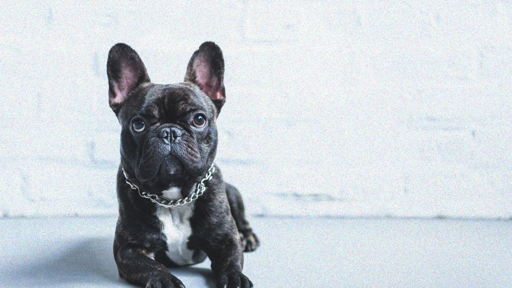
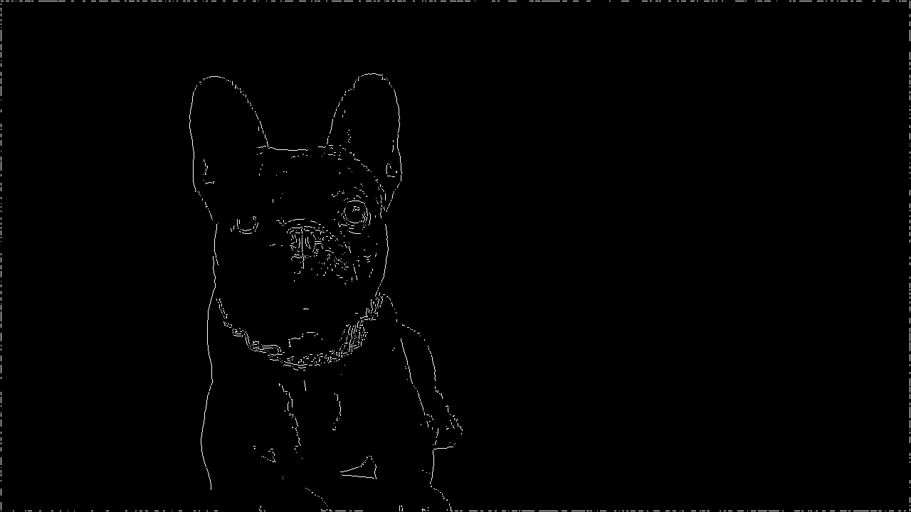

# Turtle Draw ROS

Projeto em ROS 2 para desenhar, no `turtlesim`, o contorno de uma imagem processada no notebook.

## Visão geral

O fluxo do projeto é dividido em três etapas:

1. `processamento.ipynb` processa `dog.jpg` e gera a imagem final de bordas.
2. `turtle_draw_pkg/turtle_draw_pkg/vision_pipeline.py` lê `edges_final.png` e converte os pixels ativos em segmentos no espaço lógico do `turtlesim`.
3. `turtle_draw_pkg/turtle_draw_pkg/draw_node.py` percorre esses segmentos no ROS 2, controlando movimento, teleporte e caneta.

## Imagem original e resultado de bordas

A fotografia do cachorro em `dog.jpg` é a entrada do processamento. O arquivo
`edges_final.png` contém os pixels de borda selecionados para formar o desenho.
https://github.com/loreggarcia/ROS-Vis-o-Computacional/tree/main
| Imagem original | Bordas finais (edges) |
| --- | --- |
|  |  |

## Vídeo do projeto do cachorro

<video controls width="640" src="Dog-video.mp4">
  Seu visualizador não suporta reprodução de vídeo.
</video>eo.mp4
README.md
dog.jpg
edges_final.png
processamento.ipynb
ROS-Vis-o-Computacional
/
README.md
in
main

Edit

Preview
Indent mode

Spaces
Indent size

2
Line wrap mode

Soft wrap
Editing README.md file contents
  1
  2
  3
  4
  5
  6
  7
  8
  9
 10
 11
 12
 13
 14
 1


## Processo de criação

### 1. Preparação da imagem no notebook

O processamento foi organizado em etapas no [notebook](processamento.ipynb),
com visualizações intermediárias para acompanhar a transformação da fotografia:

1. **Leitura e escala de cinza:** o OpenCV carrega `dog.jpg` em BGR. O notebook
   converte os canais para RGB e calcula a luminância com
   `0.299 R + 0.587 G + 0.114 B`, produzindo uma matriz de intensidade.
2. **Filtragem:** aplica uma convolução com um kernel normalizado de tamanho
   `3 × 3` e parâmetro `sigma = 1.4` antes de calcular os gradientes.
3. **Detecção de variações:** os operadores Sobel X e Y calculam os gradientes
   horizontal e vertical. A magnitude combinada é normalizada entre 0 e 255.
4. **Afinamento:** a supressão de não-máximos compara cada pixel com seus
   vizinhos na direção do gradiente e preserva os máximos locais.
5. **Seleção das bordas:** a limiarização dupla separa pixels fortes, fracos e
   descartados. O limiar alto corresponde a 30% da intensidade máxima; o baixo,
   a 40% do limiar alto. A máscara final mantém somente os pixels fortes
   (`img_limiarizada == 255`), sem uma etapa de histerese para recuperar os fracos.
6. **Limpeza e exportação:** uma margem de dois pixels é zerada nas extremidades
   para remover a moldura. A máscara binária é salva em `edges_final.png`, com
   fundo preto (0) e bordas brancas (255).

### 2. Conversão das bordas em trajetórias

A [pipeline de visão](turtle_draw_pkg/turtle_draw_pkg/vision_pipeline.py) lê o
PNG exportado e prepara os caminhos que a tartaruga irá percorrer:

- Binariza a imagem, remove a margem externa e filtra componentes conectados
  conforme o tamanho mínimo e o limite de componentes configurados.
- Aplica fechamento morfológico e dilatação com kernel `3 × 3`, conectando
  pequenas falhas e reforçando traços finos.
- Extrai contornos com `cv2.findContours`, reduz pontos próximos e ordena os
  segmentos de cima para baixo e da esquerda para a direita.
- Escala e centraliza o desenho na arena de 11 unidades, usando uma área útil
  de 10 unidades e preservando as proporções. O eixo vertical é invertido para
  converter as coordenadas da imagem para as do simulador.

O notebook também visualiza o mapeamento espacial, mas usa trechos obtidos por
varredura horizontal; o código executado no ROS usa a extração de contornos.

### 3. Desenho com ROS 2

O [nó de desenho](turtle_draw_pkg/turtle_draw_pkg/draw_node.py) recebe a posição
atual pelo tópico `/turtle1/pose` e publica velocidades em `/turtle1/cmd_vel`.
Um controlador proporcional ajusta o movimento de acordo com a distância e a
orientação até o próximo ponto, respeitando os limites de velocidade.

Entre segmentos, o nó desativa a caneta e usa `/turtle1/teleport_absolute` para
reposicionar a tartaruga no início do próximo traço. Depois, reativa a caneta e
percorre os pontos. Isso evita linhas ligando partes separadas do cachorro.

Para uma descrição detalhada das funções, consulte o
[relatório de arquitetura](docs/relatorio_arquitetura.md).

## Estrutura das pastas

```text
.
├── docs/
│   └── relatorio_arquitetura.md
├── processamento.ipynb
├── dog.jpg
├── Dog-video.mp4
├── edges_final.png
├── README.md
└── turtle_draw_pkg/
    ├── package.xml
    ├── setup.py
    ├── setup.cfg
    ├── resource/
    │   └── turtle_draw_pkg
    ├── test/
    │   ├── test_copyright.py
    │   ├── test_flake8.py
    │   └── test_pep257.py
    └── turtle_draw_pkg/
        ├── __init__.py
        ├── draw_node.py
        └── vision_pipeline.py
```

## O que cada parte faz

- `processamento.ipynb`: concentra as etapas de visão computacional e a validação visual do contorno.
- `dog.jpg`: imagem de entrada usada no notebook.
- `Dog-video.mp4`: vídeo do cachorro, disponível pelo link acima.
- `edges_final.png`: saída final do notebook, usada como entrada do runtime ROS.
- `docs/relatorio_arquitetura.md`: relatório explicando o código e as decisões de implementação.
- `turtle_draw_pkg/package.xml`: metadados e dependências ROS 2 do pacote.
- `turtle_draw_pkg/setup.py` e `setup.cfg`: configuração do pacote Python.
- `turtle_draw_pkg/turtle_draw_pkg/vision_pipeline.py`: converte a imagem binária em segmentos para o `turtlesim`.
- `turtle_draw_pkg/turtle_draw_pkg/draw_node.py`: nó ROS 2 que desenha os segmentos.
- `turtle_draw_pkg/test/`: testes básicos de estilo e empacotamento.

## Pré-requisitos

- ROS 2 Humble
- `turtlesim`
- Python com `numpy` e `opencv-python`
- ambiente onde o comando `ros2` esteja disponível

Neste workspace, os comandos foram executados com o ambiente:

```bash
export PATH="/home/lorena/.local/share/mamba/envs/ros2-humble/bin:$PATH"
source /home/lorena/.local/share/mamba/envs/ros2-humble/setup.bash
```

## Como gerar a imagem de bordas

1. Abra `processamento.ipynb`.
2. Execute as células do notebook até obter `bordas_binarias`.
3. Exporte a imagem final:

```python
import cv2
cv2.imwrite('edges_final.png', (bordas_binarias * 255).astype('uint8'))
```

Se `edges_final.png` já existir e estiver correto, essa etapa pode ser pulada.

## Como compilar

Na raiz do projeto:

```bash
cd /home/lorena/ponderada-ROS
export PATH="/home/lorena/.local/share/mamba/envs/ros2-humble/bin:$PATH"
source /home/lorena/.local/share/mamba/envs/ros2-humble/setup.bash
colcon build --packages-select turtle_draw_pkg
source install/setup.bash
```

## Como executar

Em um terminal, inicie o `turtlesim`:

```bash
export PATH="/home/lorena/.local/share/mamba/envs/ros2-humble/bin:$PATH"
source /home/lorena/.local/share/mamba/envs/ros2-humble/setup.bash
cd /home/lorena/ponderada-ROS
source install/setup.bash
ros2 run turtlesim turtlesim_node
```

Em outro terminal, execute o nó de desenho:

```bash
export PATH="/home/lorena/.local/share/mamba/envs/ros2-humble/bin:$PATH"
source /home/lorena/.local/share/mamba/envs/ros2-humble/setup.bash
cd /home/lorena/ponderada-ROS
source install/setup.bash
ros2 run turtle_draw_pkg draw_node --ros-args -p image_path:=/home/lorena/ponderada-ROS/edges_final.png
```

## Parâmetros úteis do nó

Os parâmetros mais relevantes de `draw_node.py` são:

- `image_path`: caminho do PNG binário final.
- `min_component_size`: tamanho mínimo de componente conectada mantida.
- `max_components`: número máximo de componentes preservadas.
- `point_spacing_pixels`: espaçamento mínimo entre pontos após redução.
- `distance_tolerance`: tolerância para considerar um ponto atingido.
- `linear_gain` e `angular_gain`: ganhos do controlador proporcional.
- `max_linear_speed` e `max_angular_speed`: saturações de velocidade.
- `pen_width`: largura da caneta.
- `reset_turtlesim_on_start`: limpa a arena antes de desenhar.

Exemplo com parâmetros explícitos:

```bash
ros2 run turtle_draw_pkg draw_node --ros-args \
  -p image_path:=/home/lorena/ponderada-ROS/edges_final.png \
  -p min_component_size:=20 \
  -p max_components:=80 \
  -p point_spacing_pixels:=1.0
```

## Observações

- `build/`, `install/`, `log/` e `__pycache__/` são artefatos gerados e não fazem parte do código-fonte.
- Sempre que alterar o pacote ROS, faça novo `colcon build`.
- Se `ros2` não for encontrado, o problema é ambiente, não o código do projeto.
